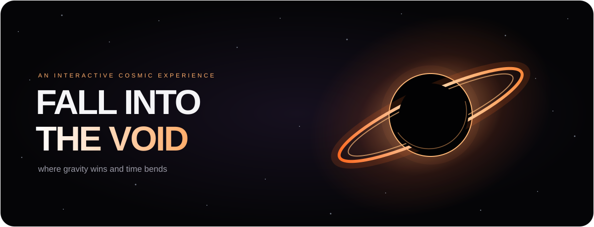
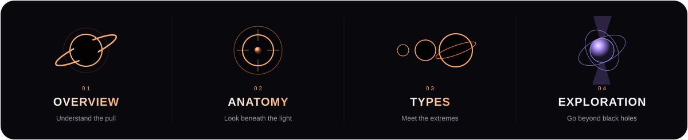

<h1 align="center">
  <a href="https://black-holes-gamma.vercel.app/#top"> DIVE INTO BLACK HOLES</a>
</h1>

<p align="center">
  
</p>

<p align="center">where gravity wins and time bends</p>

<p align="center">An interactive journey through darkness, light, and the limits of what we know</p>

## Take the first step into the void

This is not a page you simply read. It is an experience you move through

Begin beside a glowing black hole. Scroll, and watch it shrink into the page rail, following your descent. The name in the navigation disappears into its own tiny void. Stars drift behind the story. At the end, the same black hole leaves the rail and comes to rest in the footer

Between those moments, hover, drag, and explore. Every interaction opens another layer of the universe

<p align="center">
  
</p>

## Choose your depth

### 01 / Overview

How do black holes form? How do they grow? Could they ever disappear? Start with three questions, then hover over each card to reveal an explanation and conceptual diagram

### 02 / Anatomy

Explore the singularity, event horizon, and accretion disk. Each card opens a closer look at the structure, with an explanation of what the illustration represents and where our understanding reaches its limits

### 03 / Types

Move from stellar black holes to the giants at the hearts of galaxies. Meet examples such as Cygnus X 1, the intermediate mass candidate HLX 1, Phoenix A, and TON 618. Images, captions, and source links connect the categories to astronomical research

Primordial black holes are presented as hypothetical, rather than as a confirmed discovery

### 04 / Exploration

Black holes are only part of the story. Drag a carousel of glowing objects through the space between two wormhole mouths

1. White dwarf
2. Neutron star
3. Pulsar
4. Magnetar
5. Strange quark star
6. Boson star
7. Gravastar

Objects become smaller as they move away from the center, then pinch and swirl through the portals at the edges. Hover or focus to open their explanations, or tap to keep the details open

## Built to feel connected

1. A continuous black hole journey, from the hero to the scroll rail and finally the footer
2. A navigation title that is absorbed into its icon at the same pace as the hero transition
3. A brighter drifting starfield with gentle floating motion and soft twinkling
4. Explanations that appear after a short hover, with illustrations, captions, and science links
5. A carousel with dragging, touch swiping, clickable wormhole controls, and keyboard navigation
6. Orbital LinkedIn and GitHub graphics in the footer, with subtle motion and hover glow
7. Responsive layouts and support for reduced motion preferences

## A visual experience, with scientific context

The site distinguishes observed objects, candidate identifications, and hypothetical models. Conceptual graphics are labeled inside the explanations, and reference images include links to their sources

The animated colors, sizes, and motion are part of the visual storytelling. They are not a physical scale model or a numerical simulation

## Behind the experience

Built with HTML, CSS, JavaScript, SVG, and Canvas

The interface uses CSS gradients and transforms, scroll position, IntersectionObserver, ResizeObserver, and the Web Animations API to connect the visuals to your movement through the page

<details>
<summary>Explore the code locally</summary>

Clone the repository and serve it with a local static server

```sh
git clone https://github.com/grandest-nothing/black-holes.git
cd black-holes
python3 -m http.server 8000
```

Open http://localhost:8000 in your browser

The page starts in `index.html`. The main loader is `script.js`, with dedicated scripts for the black hole, scroll morph, starfield, learning cards, object carousel, and wormhole transitions

</details>

## Meet the creator

Created by Rodolfo Ramos

[MEET THE CREATOR](https://www.linkedin.com/in/rodolfo-ramosgn/) · [GITHUB REPO](https://github.com/grandest-nothing/black-holes)

<p align="center">Built with curiosity and gravity</p>
